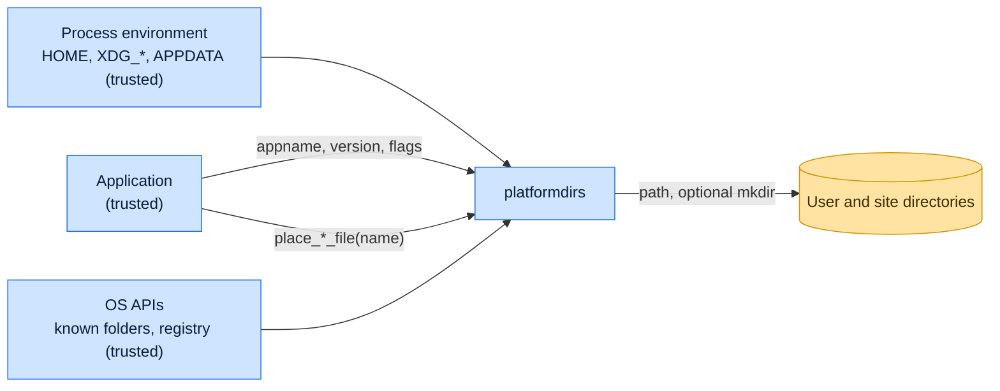

# Threat model

This model says what platformdirs trusts, where untrusted input enters, and which guarantees hold at each boundary, so a
report can be classified as a vulnerability or a bug. [SECURITY.md](SECURITY.md) covers reporting; if the two disagree,
SECURITY.md wins and we fix this file.

## How platformdirs works

platformdirs computes paths; it does not read or write application data. On Linux and other XDG systems it reads the
`XDG_*` variables and `user-dirs.dirs`, on macOS and iOS it uses the documented `Library` locations, on Windows it asks
`SHGetKnownFolderPath` (or the registry or environment where `ctypes` is missing), and on Android it reads the app's
data paths. It creates directories only when the caller sets `ensure_exists` or calls a `place_*_file` helper.

## Compared with similar tools

We drew the boundary where comparable projects in other ecosystems draw theirs. The shared rule, stated by the
[Node.js threat model](https://github.com/nodejs/node/blob/main/SECURITY.md#the-nodejs-threat-model), is that a report
which first needs a trusted element compromised is out of scope; the first triage question, as
[DOMPurify](https://github.com/cure53/DOMPurify/blob/main/SECURITY.md#what-we-consider-a-vulnerability) puts it, is what
the attacker controls.

| Project                                                       | Language   | Where it draws the line                                                                                      |
| ------------------------------------------------------------- | ---------- | ------------------------------------------------------------------------------------------------------------ |
| [Go `os.UserConfigDir`](https://pkg.go.dev/os#UserConfigDir)  | Go         | Reads `$XDG_CONFIG_HOME` and returns an error when it is relative; the environment is trusted input.         |
| [Rust `dirs`](https://docs.rs/dirs/latest/dirs/)              | Rust       | Computes the same XDG, Known Folder and macOS locations without creating them and publishes no threat model. |
| [env-paths](https://github.com/sindresorhus/env-paths#readme) | JavaScript | Returns paths only and leaves creating them, with whatever mode, to the caller.                              |

## Trusted

An attacker who controls any of these already has what platformdirs could give them:

- The calling application and every argument it passes, apart from the `name` given to `place_*_file`.
- The process environment, including `HOME`, `XDG_*`, `WIN_PD_OVERRIDE_*`, `PROGRAMDATA` and the Android variables.
- The operating system's folder APIs and registry, and the user's `user-dirs.dirs`.
- The filesystem above the returned directories.

## Untrusted inputs

| Input                                           | Comes from                                             | What platformdirs guarantees                                                              |
| ----------------------------------------------- | ------------------------------------------------------ | ----------------------------------------------------------------------------------------- |
| `name` passed to `place_*_file`                 | Possibly derived from external data by the application | Rejects an empty, absolute or drive-qualified name and one that climbs out with `..`.     |
| Relative XDG values                             | A misconfigured environment                            | Ignored, as the XDG Base Directory specification requires; only absolute values are used. |
| Missing directories on the way to a placed file | A fresh account or wiped home                          | Created with mode `0o700`, including the user directory itself.                           |

## Threats and controls

| STRIDE                 | Threat                                                                              | Control                                                  |
| ---------------------- | ----------------------------------------------------------------------------------- | -------------------------------------------------------- |
| Tampering              | A crafted `name` makes `place_config_file` return `~/.ssh/authorized_keys`.         | Absolute, drive and `..` names raise `ValueError`.       |
| Information disclosure | A placed file's new parent directory is world-readable.                             | `place_*_file` creates missing directories with `0o700`. |
| Elevation of privilege | A relative `XDG_CONFIG_HOME` resolves against an attacker-chosen working directory. | Relative XDG values are ignored.                         |

## Release chain

Releases run on the shared [tox-dev/github-workflows](https://github.com/tox-dev/github-workflows) pipeline. A release
App, not a person, pushes the release commit and tag; the build installs its tools hash-checked from `pylock.toml` with
a seven-day upload cooldown; PyPI receives the files through
[trusted publishing](https://docs.pypi.org/trusted-publishers/) with attestations, and the GitHub Release is immutable.
Every workflow pins third-party actions to a commit SHA.

## Vulnerability or bug

| Report                                                                           | Verdict             | Why                                                                                |
| -------------------------------------------------------------------------------- | ------------------- | ---------------------------------------------------------------------------------- |
| `place_config_file("../../.bashrc")` returns a path outside the config directory | Vulnerability       | The guarantee on `name` is broken.                                                 |
| `XDG_CONFIG_HOME=/tmp/evil` makes the app read config from `/tmp/evil`           | Not a vulnerability | The environment is trusted.                                                        |
| `user_cache_dir` with `ensure_exists=True` creates a `0o755` directory           | Not a vulnerability | `ensure_exists` uses the default mode; use `place_*_file` for private directories. |
| A Windows Known Folder redirected to a network share is returned as-is           | Expected            | The OS answer is trusted.                                                          |

## Accepted risks

- Directories that already exist keep their mode; platformdirs does not tighten them.
- On Windows a fully qualified `WIN_PD_OVERRIDE_*` variable replaces the Known Folder answer; the environment is
  trusted.

## Keeping this current

Revisit this model when platformdirs gains a new input source, network access, a new way to run code, or a new place it
writes to, and whenever an advisory is published.
