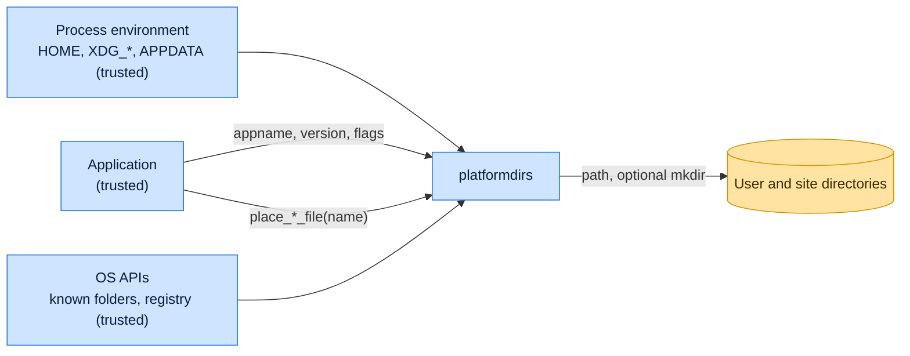

# Threat model

This model says what platformdirs trusts, where untrusted input enters, and which guarantees hold at each boundary, so a
report can be classified as a vulnerability or a bug. [SECURITY.md](SECURITY.md) covers reporting; if the two disagree,
SECURITY.md wins and we fix this file.

## How platformdirs works

platformdirs computes paths; it does not read or write application data. On Linux, macOS and other Unix systems it
honors absolute `XDG_*` variables, it reads media directories from `user-dirs.dirs`, and otherwise it uses each
platform's documented locations: `Library` on macOS and iOS, the app's data paths on Android, and on Windows the Known
Folders from `SHGetKnownFolderPath` (the registry or environment when `ctypes` is missing). `appname`, `appauthor`,
`version` and the `name` of `place_*_file` and `find_*_file` must stay inside the base directory. Directories are
created only under `ensure_exists` or by `place_*_file`; on Unix, macOS, Android and iOS the user data, config, cache,
state, log and runtime directories get `0o700`. A pytest plugin redirects every directory during tests.

## Compared with similar tools

We drew the boundary where comparable projects in other ecosystems draw theirs. The shared rule, stated by the
[Node.js threat model](https://github.com/nodejs/node/blob/main/SECURITY.md#the-nodejs-threat-model), is that a report
which first needs a trusted element compromised is out of scope; the first triage question, as
[DOMPurify](https://github.com/cure53/DOMPurify/blob/main/SECURITY.md#what-we-consider-a-vulnerability) puts it, is what
the attacker controls.

| Project                                                       | Language   | Where it draws the line                                                                                      |
| ------------------------------------------------------------- | ---------- | ------------------------------------------------------------------------------------------------------------ |
| [Go `os.UserConfigDir`](https://pkg.go.dev/os#UserConfigDir)  | Go         | Reads `$XDG_CONFIG_HOME` and returns an error when it is relative; the environment is trusted input.         |
| [Rust `dirs`](https://docs.rs/dirs/latest/dirs/)              | Rust       | Computes the same XDG, Known Folder and macOS locations without creating them and publishes no threat model. |
| [env-paths](https://github.com/sindresorhus/env-paths#readme) | JavaScript | Returns paths only and leaves creating them, with whatever mode, to the caller.                              |

## Trusted

An attacker who controls any of these already has what platformdirs could give them:

- The calling application and the base directories and options it chooses.
- The process environment, including `HOME`, `XDG_*`, `WIN_PD_OVERRIDE_*`, `PROGRAMDATA` and the Android variables.
- The operating system's folder APIs and registry, and the user's `user-dirs.dirs`.

## Untrusted inputs

| Input                                                                                 | Comes from                                                                                 | What platformdirs guarantees                                                                                                                                                                                                                        |
| ------------------------------------------------------------------------------------- | ------------------------------------------------------------------------------------------ | --------------------------------------------------------------------------------------------------------------------------------------------------------------------------------------------------------------------------------------------------- |
| `appname`, `appauthor`, `version`, and the `name` of `place_*_file` and `find_*_file` | Possibly derived by the application from package metadata, plugins or remote configuration | Rejects an absolute or drive-qualified value and one that climbs out with `..`.                                                                                                                                                                     |
| Existing entries in a shared parent                                                   | Another local user who can write that parent                                               | Must not make platformdirs create or return a path outside the chosen base; report any way it does.                                                                                                                                                 |
| `$XDG_RUNTIME_DIR`, the default runtime directory and the temporary fallback          | The session, or another user on a shared `/tmp`                                            | The first two are used only as a directory, not a symlink, owned by the user with mode `0o700`; otherwise platformdirs falls back. The temporary fallback raises `PermissionError` when it is a symlink, not a directory, or owned by another user. |
| Relative XDG values                                                                   | A misconfigured environment                                                                | Ignored, as the XDG Base Directory specification requires; only absolute values are used.                                                                                                                                                           |

## Threats and controls

| STRIDE                 | Threat                                                                                     | Control                                                                                                                                              |
| ---------------------- | ------------------------------------------------------------------------------------------ | ---------------------------------------------------------------------------------------------------------------------------------------------------- |
| Tampering              | A crafted `name` makes `place_config_file` return `~/.ssh/authorized_keys`.                | Absolute, drive and `..` values raise `ValueError` for `name`, `appname`, `appauthor` and `version`.                                                 |
| Information disclosure | A new user directory is readable by other users.                                           | On Unix, macOS, Android and iOS the user data, config, cache, state, log and runtime directories are created with `0o700`.                           |
| Tampering              | Another user plants the runtime directory in a shared `/tmp`.                              | The runtime directory is refused when it is a symlink or owned by another user.                                                                      |
| Tampering              | Another user plants `/Library/Caches/<appname>` on macOS before the site cache is created. | Under `ensure_exists`, that entry raises `PermissionError` when it is a symlink, not a directory, or owned by a user other than root and the caller. |
| Elevation of privilege | A relative `XDG_CONFIG_HOME` resolves against an attacker-chosen working directory.        | Relative XDG values are ignored.                                                                                                                     |

## Release chain

Releases run on the shared [tox-dev/github-workflows](https://github.com/tox-dev/github-workflows) pipeline. A release
App, not a person, pushes the release commit and tag; the build installs its tools from a hash-checked `pylock.toml`
resolved with a seven-day upload cooldown by default; PyPI receives the files through
[trusted publishing](https://docs.pypi.org/trusted-publishers/) with attestations, and the GitHub Release is immutable.
Every workflow pins third-party actions to a commit SHA.

## Vulnerability or bug

| Report                                                                           | Verdict             | Why                                             |
| -------------------------------------------------------------------------------- | ------------------- | ----------------------------------------------- |
| `place_config_file("../../.bashrc")` returns a path outside the config directory | Vulnerability       | The guarantee on `name` is broken.              |
| `PlatformDirs(appname="../../etc")` resolves outside the base                    | Vulnerability       | `appname` must stay inside the base.            |
| `XDG_CONFIG_HOME=/tmp/evil` makes the app read config from `/tmp/evil`           | Not a vulnerability | The environment is trusted.                     |
| `user_cache_dir` with `ensure_exists=True` creates a `0o755` directory on Linux  | Vulnerability       | User cache directories must be created `0o700`. |
| A Windows Known Folder redirected to a network share is returned as-is           | Expected            | The OS answer is trusted.                       |

## Severity

- **High:** an untrusted name escapes its base, or a symlink or race in a shared parent makes `ensure_exists` or
  `place_*_file` act on an arbitrary path, with the caller's privileges.
- **Medium:** a new user or runtime directory exposes its contents to another local user, or `find_*_file` returns
  another user's file against its documented search order.
- **Low:** a crafted value causes a crash, hang or malformed path without crossing a filesystem or user boundary.

## Accepted risks

- Directories that already exist keep their mode; platformdirs does not tighten them.
- On Windows, and for media directories such as Downloads, directories are created without an explicit mode.
- On Windows, an existing directory another user created in a shared parent such as `C:\ProgramData` is used as-is: it
  stays inside the base, and Windows 11 stops an elevated process from following a junction a standard user planted
  there.
- A fully qualified `WIN_PD_OVERRIDE_*` variable replaces the Known Folder answer; the environment is trusted.

## Keeping this current

Revisit this model when platformdirs gains a new input source, network access, a new way to run code, or a new place it
writes to, and whenever an advisory is published.
